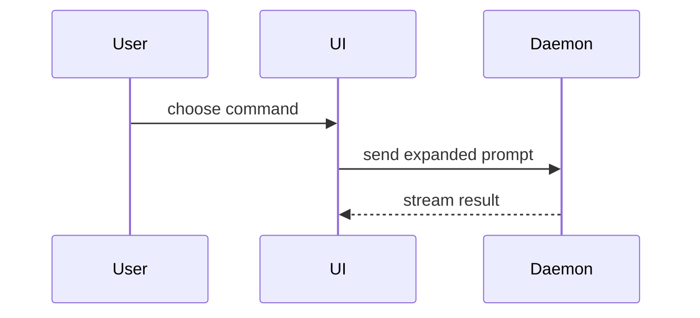

写 PR 正文时使用这个模板：

```markdown
## Summary

<diagram, diff-sketch, or tree>

## Evidence

- **Before:** <screenshot/output/failing test run>
  **After:** <screenshot/output/passing test run>

## Merge Danger

**Door:** <one-way or two-way>

<optional: description>

**Blast Radius:** <one-word description>

<optional: potential ramifications of merge>
```

## 各节

跳过所有开场白，文字保持简短。使用 `GLOSSARY.md` 里用户的领域语言。

### Summary（摘要）

挑能让关键点清楚的最小视图。

- 用伪代码展示逻辑或算法：

```text
on(save)
  if content is unchanged
    return cached result
  write new content
  return fresh result
```

- 用调用树展示运行时控制流：

```text
submitForm
  createSession
    persistPrompt
    launchAgent
  navigateToSession
```

- 用组件树展示 UI 结构，包括要紧的状态和模块边界：

```text
<SessionPage> (apps/example/src/routes/session.tsx)
  useSessionEvents()
  <SessionToolbar>
    <RunSkillButton> (packages/ui)
```

- 用浅文件树展示文件职责或大范围重构：

```text
src/
├── commands/       # parses user actions
├── sessions/       # owns session state
└── transport/      # sends API requests
```

- 用 Mermaid 展示组件交互、控制流或数据流：



- 当重点是"什么变了"、且周围形状已存在时，用 `diff`。让 diff 形状匹配主题。

组件变更：

```diff
 <SessionPage>
   useSessionEvents()
   <SessionToolbar>
+    <RunSkillButton />
   <SessionTimeline>
+    <SkillResultCard />
```

文件布局变更：

```diff
 src/
 ├── commands/
+│   └── show-me.ts       # expands the slash command
 ├── sessions/
-└── transport.ts
+└── transport/
+    ├── client.ts
+    └── stream.ts
```

调用树或调用栈变更：

```diff
 submitForm
   createSession
     persistPrompt
+    expandSkillMention
     launchAgent
-  navigateToSession
+  navigateToSession
+    subscribeToEvents
```

状态或控制流变更：

```diff
 on(save)
-  write content
+  if content is unchanged
+    return cached result
+  write new content
+  invalidate cache
```

- 当一个块大部分是新的、省略上下文会掩盖归属或顺序、或用户需要一个可复制的目标形状时，展示整块：

```ts
function expandSkill(command: string): string {
  const skillName = command.slice(1);
  return `use the ${skillName} skill`;
}
```

#### 指引

把每个可视化放在它所支持的短文字旁边。只保留回答用户当前问题或化解当前讨论点所需的调用、文件、props、状态和边界。

这些可视化你可用一个，可用几个，不太可能全用。自行判断，别淹没用户。

### Evidence（证据）

变更可用的具体证据。展示 before 和 after。

截图是 S 级——当环境配置到位且变更是视觉性的时。

基于执行的证据是 A 级。测试结果、控制台输出。用伪代码展示如今先失败后通过的那个测试。

### Merge Danger（合并风险）

描述这是一扇单向门还是双向门。双向门可以走回去，单向门不行。回滚成本低的 PR 风险更低。涉及破坏性动作或难以逆转决策的变更是单向门。

爆炸半径（blast radius）是这个 PR 引入的变更的潜在影响或范围。考虑所有可能性。例子有布局偏移、对消费方的破坏、移动端响应式等。
